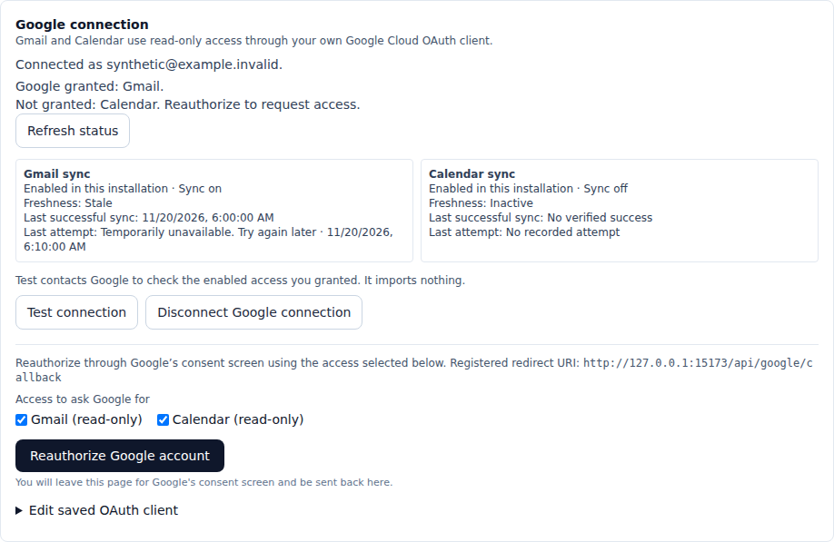
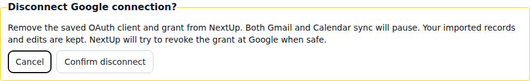

# Development notes

NextUp is pre-release. This page describes the tooling that exists in the repository and states what has and has not been validated. It is not an installation guide, and no platform is supported yet.

## What has been validated

| Item | State |
|---|---|
| Full verification in a disposable stack (`scripts/verify_ci.py`) | Run on Linux (x86-64) with Docker Engine and the Compose plugin |
| The same on macOS or Windows | Not tested |
| The hosted workflow in `.github/workflows/ci.yml` | Runs the same verification on a hosted `ubuntu-24.04` runner for every pull request and every push to `main`. Passing on `main` on 2026-11-13, for example [this run](https://github.com/westondunn/nextup-get-hired/actions/runs/43538353763) at commit `7370e9a`. Current results are on the [Actions page](https://github.com/westondunn/nextup-get-hired/actions/workflows/ci.yml?query=branch%3Amain) |
| The local development launcher (`scripts/local.py`) | Covered by unit tests; not yet validated on a clean machine |
| Display of dates in the Search Plan view outside UTC | Unit-tested in UTC and America/Chicago across the 2027-03-14 and 2026-11-01 clock changes (`frontend/src/hub/SearchPlanView.dst.test.tsx`), in [this hosted run](https://github.com/westondunn/nextup-get-hired/actions/runs/43672928458) at commit `c143b87`. An all-day calendar event is shown by its date, with no time ([#38](https://github.com/westondunn/nextup-get-hired/issues/38)). No zone east of UTC is tested, and there is no browser test |
| Calendar import across daylight-saving changes | Unit-tested with synthetic events (`backend/tests/test_calendar_dst.py`), in [this hosted run](https://github.com/westondunn/nextup-get-hired/actions/runs/43658531564) at commit `be66581`. An event time without an offset is read in the zone the event names ([#39](https://github.com/westondunn/nextup-get-hired/issues/39)). No live calendar has been used, so it is not known whether the provider sends that form |

## Requirements

- Docker Engine with the Compose plugin.
- Python 3.12 or later on the host, for the scripts. They use the standard library only.
- Optional: PyYAML, for the tooling tests that parse the Compose files. Without it those tests are skipped, so a local run can pass where the hosted workflow, which has it, fails.

Everything else (Python and Node dependencies, PostgreSQL, Redis, browsers for the end-to-end tests) runs in containers.

## Full verification

```sh
NEXTUP_INTEGRATION_APPROVED=1 scripts/verify.sh
```

This builds the images and starts a disposable stack under a random project name of the form `nextup-ci-<12 hex>`. It then runs the linters, the migration round trips, the backend, frontend and browser tests, and removes the stack. It uses synthetic fixture data only, and no external integration is enabled.

- The variable is a deliberate opt-in for one run. Without it the script refuses and starts nothing.
- The run never targets a development or staging stack and never removes volumes.
- The run keeps its working files in a scratch directory outside the repository: `nextup-ci-<uid>` under the system temporary directory, or the directory named by `NEXTUP_CI_SCRATCH_ROOT`.
- It refuses to run as root.
- Building the images downloads base images and dependencies, so the first run needs network access.

## Local development stack

This launcher is the current baseline for the [accepted core first-run design](CORE_ONBOARDING.md). Guided setup and its validation with integrations and AI off are still pending.

```sh
python3 scripts/local.py --env dev doctor    # check tools and configuration; starts nothing
python3 scripts/local.py --env dev start     # build and start
python3 scripts/local.py --env dev migrate   # show the migration plan; apply after confirmation
python3 scripts/local.py --env dev status
python3 scripts/local.py --env dev stop      # stop; data is kept
```

- `start` creates `.env.dev` from `env/dev.env.example` and generates database passwords as files under `.secrets/dev/`. Neither is committed.
- `start` also generates `.secrets/dev/setup_code`, the code that starts a local session (`POST /api/session`). An installation created before this file existed gets it on its next `start`. Changing or running mail and calendar sync requires that session; enter the code under Settings, Integrations. The session also protects saving the Google client, reading connection status, starting or renewing consent, testing the grant and disconnecting. Google returns the browser to `GET /api/google/callback`, which completes only a flow started by that session. See [decisions/0001-local-session-boundary.md](decisions/0001-local-session-boundary.md).
- `start` generates `.secrets/dev/token_key` for the encrypted Google client and grant. Only the API and worker receive the key. Staging refuses it. The launcher keeps both sync flags off. The [Google Settings walkthrough](#google-connection-in-settings) describes the controls and their behavior with synthetic data.
- `start` never migrates. Until `migrate` has initialised the schema, the services refuse to work. The same applies after an update that adds a migration revision: the services refuse with `NXG-L03` until `migrate` has been run again. `migrate` shows a read-only plan first and applies it only after you type the confirmation code it prints.
- The API and the web interface are published on the loopback interface only, by default on ports 18000 and 15173.
- Open them as `127.0.0.1` or `localhost`. The API answers `400` to any other host name, and `403` to a state-changing request that a browser reports as coming from another origin. A proxy in front of the API must forward the browser's `Host` header unchanged, as `frontend/vite.config.ts` does. See [decisions/0001-local-session-boundary.md](decisions/0001-local-session-boundary.md).
- There is no command that removes data volumes.

**The API has no authentication. Do not publish these ports on a network.**

### Google connection in Settings

Open **Settings → Integrations** and unlock the session with the installation's setup code. A shipped installation reports that Gmail and Calendar are switched off. The following controls were exercised with synthetic API responses. The clean-machine setup and live-provider checks belong to [#14](https://github.com/westondunn/nextup-get-hired/issues/14).

- In an eligible installation, save the Web application client and register the callback address shown in your own Settings. Its port depends on the installation. Select the read-only capabilities and start consent. Reauthorization uses the same Google consent screen.
- Check the report for each capability. The installation can enable a capability that the account has yet to grant. A sync attempt, a successful sync, and a connection test are separate events. The card reports when success is unknown, current or stale.
- **Test connection** checks only the enabled capabilities included in the saved grant. A successful test imports nothing. For a missing scope or revoked grant, reauthorize. For an administrator restriction, contact the account administrator. Retry a temporary outage later.
- **Disconnect** asks for confirmation, removes the saved client and grant, and pauses both syncs. Imported records and edits are preserved. An unconfirmed revocation includes instructions to check third-party access in Google Account. Credentials supplied through installation configuration are managed there. Resuming sync requires an explicit settings change.

The synthetic example shows Gmail access with a stale sync and Calendar access still to request.



Disconnect opens a confirmation with keyboard focus on **Cancel**. Escape returns to the Disconnect control.



## External integrations

Job-listing fetching (Adzuna, and Greenhouse, Lever and Ashby boards), read-only Gmail and Google Calendar sync, and the optional external classifier are switched off in every shipped configuration, and there is no supported way to enable them yet. The classifier's interface is described in [CORRESPONDENCE_SYNC.md](CORRESPONDENCE_SYNC.md). What exists in the code and what has been tested are recorded separately in [INTEGRATIONS.md](INTEGRATIONS.md).

## Branches and pull requests

Work happens on short-lived topic branches that are merged into `main` through pull requests. The naming rules, pull-request expectations and merge gates are in the [branching guide](BRANCHING.md). The guide is the maintainer's adopted workflow. Branch names are not checked automatically, and outside contributions are not being accepted yet; the policy is in [CONTRIBUTING.md](../CONTRIBUTING.md).

- The hosted workflow's check is named `verify`. It is not a required check: the `main` ruleset requires a pull request and linear history, but no passing check.
- The verification runs once for each commit pushed to a pull request, and once for each push to `main`. A branch with no pull request gets no hosted run: open a draft pull request, or start the workflow by hand from the Actions page.
- A closing keyword next to an issue number in a pull-request description closes that issue on merge, even when the sentence is negated. Linking an issue in the pull request's sidebar does the same.

## Database migrations

- The files under `backend/migrations/versions/` are pinned by SHA-256 in `backend/migrations/LINEAGE.sha256`. The migration guard refuses to run if a single byte differs, so never edit or reformat an existing revision, including its comments and line endings.
- Migrations run only through the guard, which checks which database it is connected to before it changes anything.
- Revisions added after the pinned history are named `oss_NNNN` and extend the same chain. The first is `oss_0030`. They are not added to the pin file.
